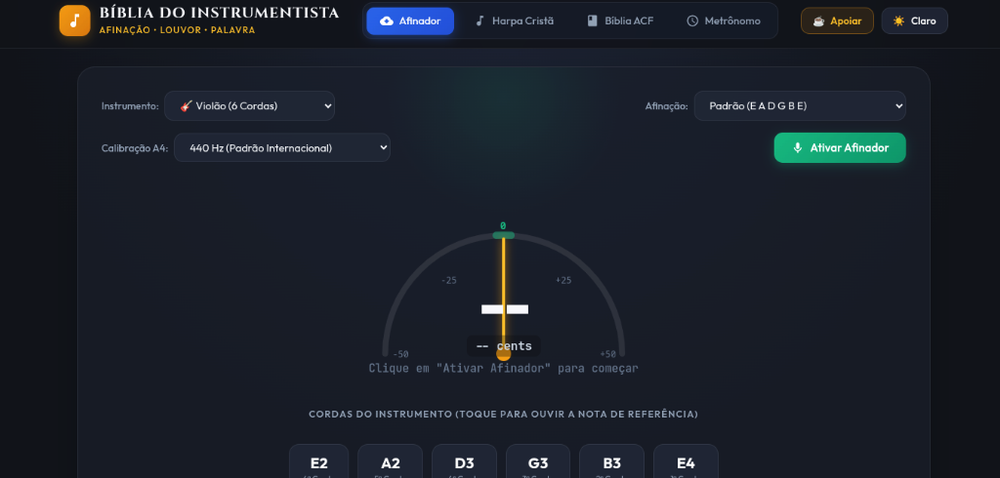
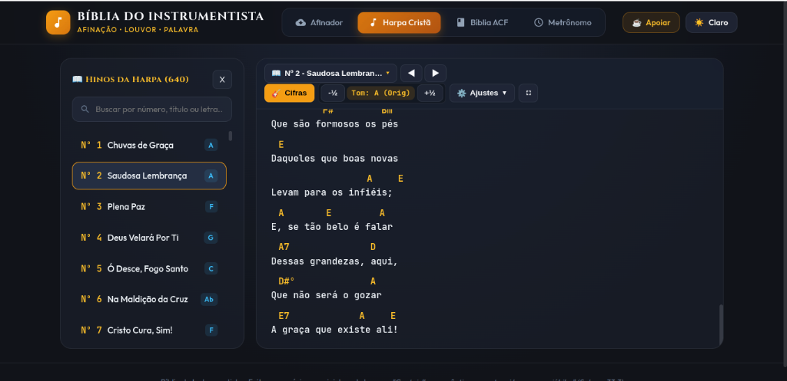
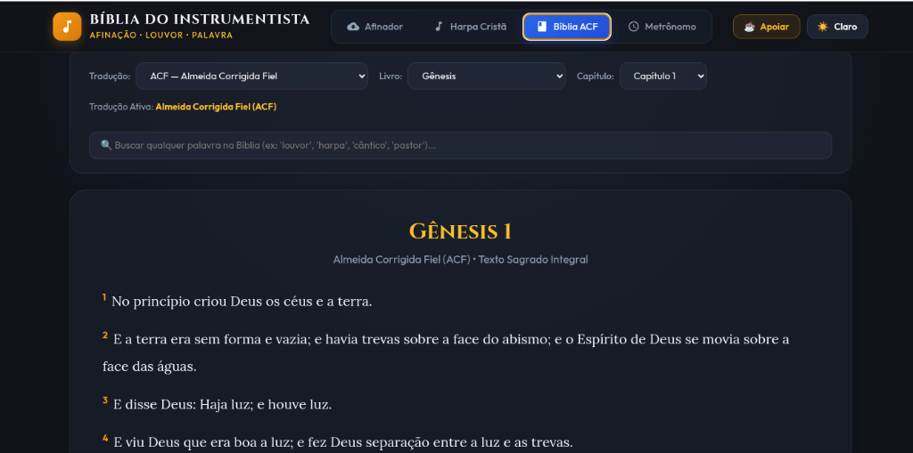
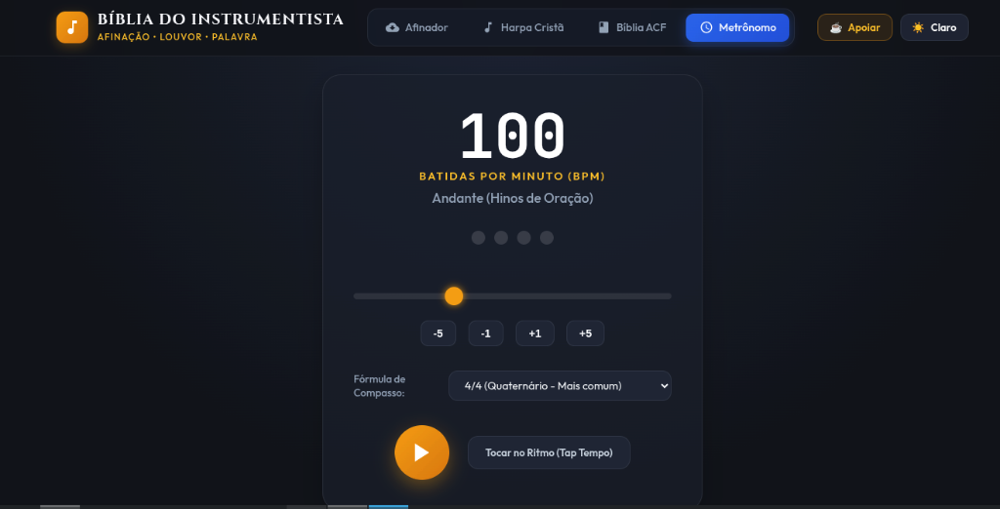

# 📖 Bíblia do Instrumentista — Apresentação Oficial do Aplicativo

> **O Ecossistema Completo para Músicos, Ministros de Louvor e Congregações**  
> *Afinação profissional, hinário com cifras dinâmicas, Escrituras Sagradas e metrônomo preciso integrados em uma única ferramenta 100% offline.*

---

## 📌 Sumário Executivo
1. [A Proposta do Aplicativo](#1-a-proposta-do-aplicativo)
2. [Módulo 1: Afinador Digital de Alta Precisão](#2-módulo-1-afinador-digital-de-alta-precisão)
3. [Módulo 2: Harpa Cristã Cifrada (640 Hinos)](#3-módulo-2-harpa-cristã-cifrada-640-hinos)
4. [Módulo 3: Bíblia Sagrada Completa](#4-módulo-3-bíblia-sagrada-completa)
5. [Módulo 4: Metrônomo Digital e Tap Tempo](#5-módulo-4-metrônomo-digital-e-tap-tempo)
6. [Design, Acessibilidade e Modos Visuais](#6-design-acessibilidade-e-modos-visuais)
7. [Plataformas e Onde Baixar](#7-plataformas-e-onde-baixar)

---

## 1. A Proposta do Aplicativo

Em muitos ensaios e cultos, o instrumentista precisa alternar entre múltiplos aplicativos no celular: um para afinar o violão, outro com o hinário da igreja, um terceiro para ler a Bíblia e um quarto aplicativo para marcar o tempo. Além da distração das notificações, a maioria desses apps exige conexão com a internet ou exibe anúncios inoportunos.

A **Bíblia do Instrumentista** foi concebida para solucionar definitivamente essa dor:
* 🎯 **Tudo em um só lugar:** Afinação, Harpa Cifrada, Bíblia e Metrônomo a 1 toque de distância;
* ⚡ **100% Offline:** Não depende de sinal de Wi-Fi ou dados móveis na igreja;
* 🕊️ **Foco no Louvor:** Zero propagandas, interface limpa e respeitosa ao ambiente de culto;
* 💻 **Multiplataforma:** Disponível para computadores **Windows**, celulares **Android** e computadores **Linux**.

---

## 2. Módulo 1: Afinador Digital de Alta Precisão

Projetado tanto para iniciantes quanto para músicos experientes, o afinador utiliza o consagrado **algoritmo YIN de autocorrelação acústica**, garantindo resposta imediata e filtragem de ruídos do ambiente.

### Principais Destaques do Afinador:
* **Instrumentos Dedicados:**
  * **Violão (6 Cordas):** Afinação Padrão (`E A D G B E`), Drop D, 1/2 Tom Abaixo, Open G e DADGAD (estilo celta/louvor contemporâneo).
  * **Contrabaixo (4 Cordas):** Padrão (`E A D G`) e Drop D.
  * **Contrabaixo (5 Cordas):** Padrão com Si grave (`B0` de 30.8 Hz) e High C.
  * **Modo Cromático Universal:** Reconhece qualquer nota para afinar violinos, cavaquinhos, teclados ou treinar a voz.
* **Calibração de Diapasão A4:** Ajustável entre `432 Hz`, `440 Hz` (padrão internacional), `442 Hz` e `444 Hz`.
* **Leitura Visual Clara:** Agulha centesimal graduada de `-50` a `+50 cents`, frequência precisa em Hertz e indicador **verde esmeralda** ao atingir a afinação ideal.
* **Notas de Referência:** Toque nas cordas na parte inferior da tela para ouvir o som senoidal exato e treinar o ouvido musical.

---

## 3. Módulo 2: Harpa Cristã Cifrada (640 Hinos)

O hinário tradicional das Assembleias de Deus e congregações pentecostais em versão digital moderna, com cifras inteligentes e transposição harmônica em tempo real.

### Recursos do Módulo de Louvor:
* **Catálogo Integral:** Todos os **640 hinos históricos** com estrofes, coros e numeração original.
* **Busca Instantânea:** Localize qualquer hino em menos de 1 segundo digitando o número, o título ou qualquer trecho da letra.
* **Transposição Dinâmica de Tom (`-½` e `+½`):** Ajuste a harmonia para o tom exato do cantor ou do pastor com 1 único toque, sem distorcer as notas.
* **Dicionário de Acordes Interativo:** Toque sobre qualquer cifra da letra para abrir imediatamente o diagrama com o desenho dos dedos no braço do violão.
* **Modo Tela Cheia:** Expanda a visualização na estante de partitura para acompanhar a letra confortavelmente à distância.

---

## 4. Módulo 3: Bíblia Sagrada Completa

A Palavra de Deus sempre à mão para o momento da ministração da Palavra, leitura devocional ou introdução do hino.

### Recursos das Escrituras:
* **Traduções Clássicas:** Textos fiéis e tradicionais (Almeida Corrigida Fiel - ACF, ARC e Tradução Brasileira).
* **Busca Temática de Palavras:** Campo inteligente para pesquisar passagens bíblicas sobre louvor, harpa, instrumentos, adoração e oração em todo o cânon bíblico.
* **Navegação Ágil:** Seletor intuitivo de Livros (Gênesis a Apocalipse) e Capítulos com paginação suave.
* **Versículos Destacados:** Numeração dourada em alto contraste para facilitar a leitura no altar e durante as ministrações.

---

## 5. Módulo 4: Metrônomo Digital e Tap Tempo

O estudo rítmico é o alicerce de qualquer ministério de louvor afinado. O metrônomo integrado garante precisão de andamento e auxílio prático durante os ensaios do grupo de louvor.

### Recursos de Andamento e Ritmo:
* **Ajuste de BPM Preciso:** Seleção contínua de 30 a 250 Batidas por Minuto via controle deslizante ou botões de incremento fino (`-1`, `+1`, `-5`, `+5`).
* **Identificação de Andamentos Tradicionais:** O visor exibe automaticamente o termo musical correspondente ao tempo selecionado (ex: *Largo*, *Adagio*, *Andante — Hinos de Oração*, *Moderato*, *Allegro*).
* **Fórmulas de Compasso:** Suporte a compassos Quaternários (`4/4`), Ternários (`3/4`), Binários (`2/4`) e Compostos (`6/8`).
* **Botão Inteligente Tap Tempo:** Descubra o andamento de qualquer hino ou música apenas tocando o botão no ritmo da batida!

---

## 6. Design, Acessibilidade e Modos Visuais

* **Modo Escuro (Midnight Navy & Amber):** Visual moderno e elegante com tons de azul meia-noite e detalhes em dourado âmbar, ideal para ambientes de palco, púlpitos e ensaios noturnos.
* **Modo Claro (Alto Contraste):** Desenvolvido especialmente para leitura sob luz solar direta ou locais com iluminação intensa, mantendo as cifras nítidas e a letra em preto absoluto.
* **Baixo Consumo de Bateria:** Arquitetura leve construída com padrões web modernos (HTML5, Vanilla CSS e Web Audio API nativo), consumindo o mínimo de processamento do aparelho.

---

## 7. Plataformas e Onde Baixar

O projeto é de código aberto e disponibilizado gratuitamente para edificar músicos e igrejas:

| Plataforma | Pacote | Como Instalar | Link Direto |
| :--- | :--- | :--- | :--- |
| **Windows Portátil** | `Biblia.do.Instrumentista.Portatil.1.0.2.exe` (~96 MB) | **Sem instalação:** execute direto com 2 cliques (ideal para pendrive). | [⬇️ **Download Portátil**](https://github.com/JonathasHenrique/biblia-do-instrumentista/releases/latest/download/Biblia.do.Instrumentista.Portatil.1.0.2.exe) |
| **Windows Instalador** | `Biblia.do.Instrumentista.Setup.1.0.2.exe` (~96 MB) | Assistente tradicional que cria atalhos no Desktop e Menu Iniciar. | [⬇️ **Download Setup**](https://github.com/JonathasHenrique/biblia-do-instrumentista/releases/latest/download/Biblia.do.Instrumentista.Setup.1.0.2.exe) |
| **Android** | `biblia-do-instrumentista.apk` (~9 MB) | Baixe o arquivo e confirme a instalação no celular. | [⬇️ **Download APK**](https://github.com/JonathasHenrique/biblia-do-instrumentista/releases/latest/download/biblia-do-instrumentista.apk) |
| **Linux Desktop** | `Biblia.do.Instrumentista-1.0.2.AppImage` (~118 MB) | Dê permissão de execução (`chmod +x`) e execute com 2 cliques. | [⬇️ **Download AppImage**](https://github.com/JonathasHenrique/biblia-do-instrumentista/releases/latest) |

> 🌐 **Código Fonte e Novas Versões:**  
> Acompanhe o projeto no GitHub oficial: [github.com/JonathasHenrique/biblia-do-instrumentista](https://github.com/JonathasHenrique/biblia-do-instrumentista)
